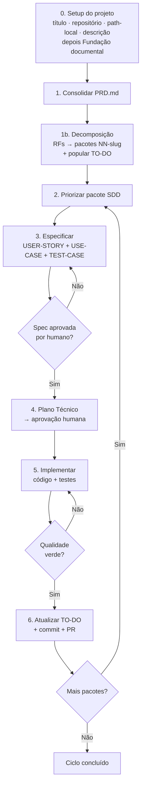

# Guideline de Desenvolvimento Agêntico & Spec-Driven Development (SDD)

> **Documento:** GUIDELINE.md  
> **Autor:** Silverio Leite Jr · Senior Solution Architect · OG1 TI  
> **E-mail:** silverio.leitejr@og1.com.br · **Telefone:** (11) 96020-6334  
> **Versão:** 1.2  
> **Data:** 2026-11-20  

> **Tipo:** Artefato agnóstico (tecnologia e projeto)  
> **Propósito:** Definir a metodologia de trabalho com agentes de IA em qualquer projeto que adote Spec-Driven Development.  
> **Reuso:** Este documento deve ser copiado integralmente para novos projetos sem alterações de conteúdo.

---

## 1. Princípios Fundamentais

1. **Spec primeiro, código depois.** Nenhuma funcionalidade é implementada sem os artefatos de especificação correspondentes revisados e aprovados em `docs/sdd/NN-slug/`.
2. **A spec é a fonte da verdade.** Se o código diverge da especificação ou do `PRD.md`, alinha-se primeiro a documentação e depois o código.
3. **Humano decide, agente executa.** O agente propõe o plano técnico; o humano aprova antes de mudanças estruturais, de modelo de dados ou de segurança.
4. **Mudanças pequenas e revisáveis.** Um PR = um pacote SDD (`NN-slug`) ou uma fatia lógica dele.
5. **Testes rastreáveis.** Todo critério de aceite e caso de teste da spec deve ser coberto por teste automatizado identificável.
6. **Zero segredos no repositório.** Credenciais, tokens e dados sensíveis nunca são commitados.

---

## 2. Fluxo de Trabalho SDD (Ponta a Ponta)

### 2.1 Diagrama



### 2.2 Etapa 0 — Setup e fundação

Antes de qualquer especificação funcional:

1. **Setup do projeto:** título, repositório, path local e descrição inicial.
2. **Fundação documental:**

| Artefato | Origem | Responsável |
|----------|--------|-------------|
| `SAD.md` | Template ou geração assistida | Solution Architect |
| `DATABASE-PATTERN.md` | Template | Solution Architect |
| `NAMING-CONVENTION.md` | Template | Solution Architect |
| `DESIGN.md` | Template (se houver UI) | Designer / Architect |
| `AGENTS.md` | `docs/templates/AGENTS-TEMPLATE.md` | Tech Lead |
| `TO-DO.md` | Template inicial | Product Owner / Architect |

**Critério de saída:** o setup está registrado e os artefatos acima existem e foram revisados pelo menos uma vez. `DESIGN.md` só é exigido quando o produto tem interface.

### 2.3 Etapa 1b — Decomposição

Após o PRD aprovado:

1. Identificar os Requisitos Funcionais (`RF-xx`) que formam unidades coesas.
2. Criar um pacote `docs/sdd/NN-slug/` para cada unidade.
3. Registrar na matriz do `TO-DO.md` o mapeamento:
   - `RF-xx` → `US-NN` → `UC-NN` → `TC-NN.xx`
4. Definir prioridade inicial de cada pacote.

**Critério de saída:** TO-DO.md contém a matriz completa e pelo menos um pacote priorizado.

### 2.4 Demais etapas

| # | Etapa | Entrada | Saída | Critério |
|---|-------|---------|-------|----------|
| 2 | Priorizar pacote | TO-DO | Pacote selecionado | Escopo claro |
| 3 | Especificar | RF do PRD | USER-STORY + USE-CASE + TEST-CASE | Spec aprovada |
| 4 | Planejar | Spec aprovada | Plano técnico | Aprovação humana |
| 5 | Implementar | Plano aprovado | Código + testes | Qualidade verde |
| 6 | Entregar | Testes verdes | TO-DO atualizado + PR | PR integrado |

---

## 3. Convenção de Pacotes e Nomenclatura

```text
docs/sdd/NN-slug/
├── USER-STORY-NN-SLUG_UPPER.md
├── USE-CASE-NN-SLUG_UPPER.md
├── TEST-CASE-NN-SLUG_UPPER.md
└── ASCII-MOCKUP-NN-SLUG_UPPER.md   ← só se a Extensão A estiver ativa
```

**Regras fixas:**
- `NN` = dois dígitos (01, 02…)
- `slug` = kebab-case (ex.: `canvas-colaborativo`)
- `SLUG_UPPER` = slug em MAIÚSCULAS com hífen (ex.: `CANVAS-COLABORATIVO`)
- Nome de arquivo: `TIPO-NN-SLUG_UPPER.md` (sem sufixo `-REQUIREMENTS`)

### Convenção de IDs de Rastreabilidade

| Tipo | Formato | Exemplo | Escopo |
|------|---------|---------|--------|
| Requisito funcional | `RF-NN` | `RF-01` | PRD |
| Critério de aceite do PRD | `CA-NN` | `CA-01` | PRD |
| Regra de negócio do PRD | `RN-NN.x` | `RN-01.1` | PRD |
| User Story | `US-NN` | `US-01` | Pacote |
| Critério da User Story | `CAU-NN.x` | `CAU-01.1` | User Story; cita um `CA-NN` |
| Use Case | `UC-NN` | `UC-01` | Pacote |
| Regra do Use Case | `RU-NN.x` | `RU-01.1` | Use Case; cita uma `RN-NN.x` |
| Caso de teste | `TC-NN.MM` | `TC-01.03` | Pacote |
| Decisão de arquitetura | `ADR-NNN` | `ADR-001` | `docs/ADR.md` |

---

## 4. Ordem de Leitura Canônica para Agentes

**Esta é a única ordem oficial.** Todos os demais documentos e skills devem referenciá-la.

1. `docs/GUIDELINE.md` — metodologia (este documento)
2. `docs/AGENTS.md` — contrato operacional do projeto
3. `docs/TO-DO.md` — status e priorização
4. `docs/PRD.md` — escopo funcional
5. `docs/SAD.md` — arquitetura e stack
6. `docs/ADR.md` — decisões arquiteturais (se existir)
7. `docs/DATABASE-PATTERN.md` — padrões de dados
8. `docs/NAMING-CONVENTION.md` — convenções de código e arquivos
9. `docs/DESIGN.md` — identidade visual (se aplicável)
10. `docs/sdd/NN-slug/` — spec do pacote em execução

**Skills especializadas** podem usar um subconjunto explícito desta lista, desde que declarem qual subconjunto utilizam.

---

## 5. Ciclo de Trabalho do Agente (Explore → Plan → Execute)

1. **Entender** — Resuma a tarefa, verifique status em `TO-DO.md` e liste critérios de aceite.
2. **Planejar** — Defina arquivos, riscos e solicite aprovação humana quando necessário (conforme `AGENTS.md`).
3. **Test-First** — Implemente testes derivados da spec.
4. **Implementar** — Menor mudança que satisfaça a spec.
5. **Verificar** — Execute comandos de qualidade definidos no `AGENTS.md`.
6. **Entregar** — Atualize `TO-DO.md` e publique relatório final.

---

## 6. O Que NÃO Deve Ser Feito

- Implementar sem spec aprovada.
- Alterar modelo de dados, autenticação ou dependências sem aprovação humana.
- Editar migrações já aplicadas.
- Desabilitar testes ou lint.
- Commitar segredos.
- Inventar requisitos não presentes no PRD ou na spec.

---

## 7. Definição de Pronto (DoD)

- [ ] Spec atualizada e coerente com o código
- [ ] `TO-DO.md` atualizado
- [ ] Testes da spec passando
- [ ] Comandos de qualidade do `AGENTS.md` verdes
- [ ] Alterações de banco aderentes ao `DATABASE-PATTERN.md`
- [ ] Zero segredos expostos
- [ ] Relatório final publicado

---

## 8. Formato do Relatório Final

```markdown
## Resumo
## Arquivos alterados
## Testes executados
## Desvios / suposições
## Pendências
```

## 9. Status de Artefatos de Spec

Enum único utilizado em USER-STORY, USE-CASE e TEST-CASE:

- `Draft` — em elaboração
- `Em revisão` — aguardando revisão humana
- `Aprovado` — liberado para implementação

**Regras:**
- A skill `sdd-developer` só inicia implementação se User Story, Use Case e Test Case estiverem `Aprovado`.
- Um `RF` cujo texto ainda tenha `[A VALIDAR]` não entra na Etapa 1b. `[A VALIDAR]` em outro requisito não bloqueia este.
- O PRD não pode ser marcado `Aprovado` enquanto existir qualquer `[A VALIDAR]`.
- Aprovação do Plano Técnico é registrada na seção correspondente do `TO-DO.md`.

---

## 10. Decisões de Padronização

- **ADR.md:** documento separado (opcional). Se não existir, as decisões ficam no SAD.md.
- **Identidade visual:** nome oficial é `DESIGN.md` (não DESIGN-SYSTEM.md).
- **Fonte da verdade das skills:** `docs/skills/`. Publicação para `.agents/skills/` via `scripts/sync-skills.sh`.
- **Cabeçalhos:** templates usam placeholders (`{{AUTHOR_NAME}}` etc.). GUIDELINE mantém autoria fixa por ser agnóstico.
- **Idioma de commit:** português (escopo técnico em inglês permitido).

---

*Documento agnóstico. Não customizar por projeto.*
